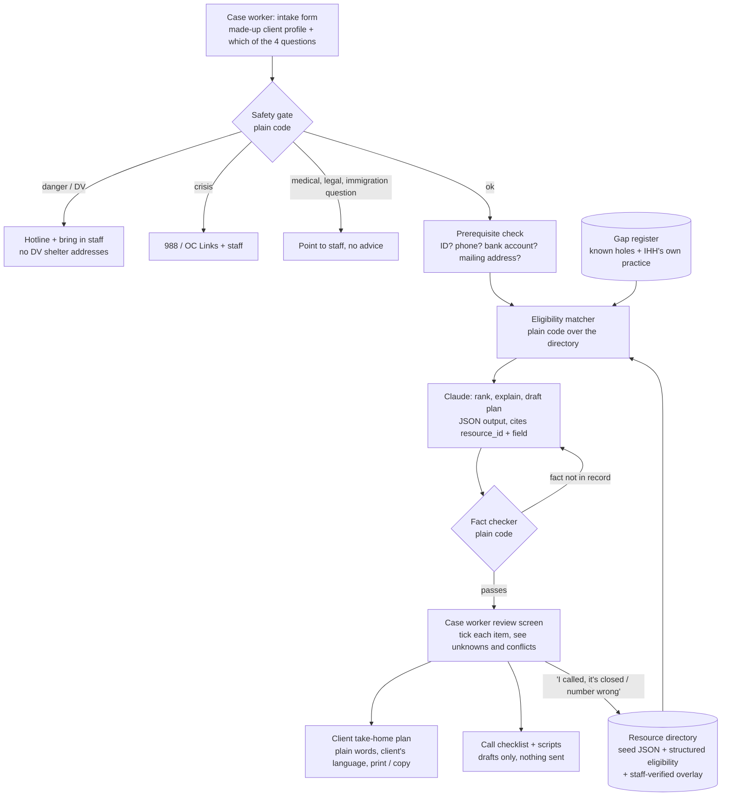
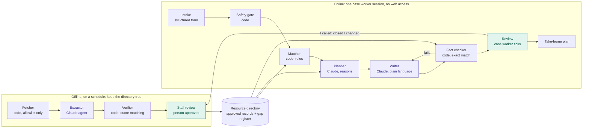

# Architecture: "Next Door" discharge resource planner

> A case worker tool that answers four questions for an IHH client leaving recuperative care
> (*Where do I sleep? Who can help me find work? Can I get a small loan? Can anyone help me get
> home to family?*) and produces a plain-language, take-home plan in the client's language.

Built on the files in this folder: `data/oc-resources.seed.json` (40 sourced entries),
`data/DATA-SOURCES.md`, and `scenarios/client-scenarios.json` (12 made-up clients).

---

## 1. Who uses it, and one tension to settle

The challenge README says the tool is **for the client**. Our goal says it is **for case
workers**. The design below does both: the **case worker drives the tool**, and the
**client gets the output** (a printable or on-screen plan in plain words). Having a case worker
in the loop is also our main quality-control step. **Team decision needed:** confirm this framing
with the IHH staff in the room.

## 2. Design principles (from the ground rules)

1. **The directory is the only source of facts.** Claude never produces a phone number, address,
   hour or eligibility rule. It only selects and rephrases fields from a resource record, and
   every fact it shows points back to `resource_id` + field.
2. **Rules before the model.** Safety checks and eligibility filtering run as plain code, before
   Claude sees anything. Claude explains the results. It does not decide who qualifies.
3. **Unknown is a first-class answer.** Every eligibility check returns `meets`, `does not meet`
   or `unknown`. A `null` in the data shows up as "unknown, ask when you call".
4. **Show age and doubt.** `verified_date`, `confidence` and conflicts in `notes` are always
   visible to the case worker.
5. **The tool sends nothing.** Messages and call scripts are drafts the case worker copies.
6. **Honest about gaps.** Loans and travel home are thin. The tool says so and does not stretch a
   weak match into a promise.

## 3. System overview



## 3b. Agents, and what stays plain code

Three Claude roles. Everything else is plain code, because code cannot make up a phone number.
The system splits into an **offline pipeline** that keeps the directory true, and an **online
path** used during a case worker session, which has no web access.



Purple = Claude agent. Green = a person checks. Everything else = plain code or data.

| Component | Kind | Job | Must not |
|---|---|---|---|
| Fetcher | Code | Fetch allowlisted URLs, respect `robots.txt` and crawl delays, save a dated snapshot, pass on only pages that changed | Fetch anything off the allowlist, or get around a block or bot check |
| **Extractor** | Claude | One pass reads *and* classifies a changed page: extracts fields with a verbatim quote each, tags the need (sleep / work / loan / travel home / other), drafts structured eligibility, flags closures, operator changes, conflicting numbers and hijacked domains | Fill a field the page does not state (write `unknown`) |
| Verifier | Code | Every quote must appear verbatim in the snapshot text; phone format check; diff against the current record; link health | Approve anything on its own |
| Staff review | Person | Approve, edit or reject each change before it reaches the directory | — |
| Safety gate | Code | Danger / DV → hotline + staff, no survivor-program addresses; crisis → 988 / OC Links; medical, legal, immigration questions → staff | Call Claude first |
| Matcher | Code | Run structured eligibility rules: `meets` / `does not meet` / `unknown` | Guess |
| **Planner** | Claude (reasoning agent) | Over the matcher's results: order the steps (ID before General Relief), weigh trade-offs, spot blockers (no phone, no bank account), list what to ask on the call, state gaps honestly. Tools: look up a directory record, get prerequisites, read the gap register | Decide eligibility, browse the web, add a fact not in a record |
| **Writer** | Claude | Turn the plan into plain words (about grade 5) in the client's language; copy phone numbers, addresses and program names exactly | Give medical, legal or immigration advice |
| Fact checker | Code | Every phone, address and hour in the Writer's text must match a cited record exactly; on failure, send back to the Writer once, then show "could not generate safely" | — |
| Review | Person | Case worker ticks each item; "I called" feeds back to staff review | — |

**Why the Writer is separate from the Planner:** the fact checker has one block of text to check,
and the Planner's reasoning never reaches the client.

### Fetch allowlist

Allowed (organizations' own pages, or sources whose terms allow reuse):

- The `source_url` and `website` of each seed entry in `data/oc-resources.seed.json`, **except**
  the domains in the blocked list below
- SAMHSA FindTreatment.gov JSON endpoint (`robots.txt` allows all; terms not yet verified)
- SBA list of microlenders (California filter)
- OC Workforce Solutions events page
- Second Harvest Food Bank pantry list and PDF
- County Pocket Guide PDFs (ceo.oc.gov get-help page)
- CAP OC / OC Food Bank partner PDFs
- 211 National Data Platform API, only after signing up and accepting its terms

Not allowed:

| Source | Why (from `data/DATA-SOURCES.md`) |
|---|---|
| findhelp.org | Terms forbid screen-scraping and storing or compiling its materials |
| 211oc.org | No terms text, `Crawl-delay: 10`, "ask before any automated use". It offers no public API; the internal JSON endpoint is not offered for reuse. Ask Orange County United Way, or use the national 211 API |
| ocnavigator.org | `robots.txt` disallows `/m/ocn/` |
| caloptima.org, kiva.org, score.org, anaheim.net | Block automated requests (429 / 406 / 403). Do not work around it; staff check these by hand |
| swcommunitycenter.org, someonecareskitchen.org | Domains no longer belong to the organization (unrelated content / redirect) |

costamesaca.gov answered only to browser-like headers. Treat it as hand-checked too, rather than
faking a browser.

### Scope for the hackathon

Build the whole online path. For the offline side, demo a "re-check this listing" button that runs
Fetcher → Extractor → Verifier on one seed entry and shows the diff for a person to approve. A
scheduled crawl is a next step, not a demo requirement.

## 4. Components

### 4.1 Intake (case worker form)

Structured fields only, no free-text narrative about the client (keeps PII out and makes rules
work). Use the 12 scenarios as test inputs.

| Field | Why it matters (examples from the seed) |
|---|---|
| Questions to answer: sleep / work / loan / travel home (multi-select) | Drives which part of the directory is searched |
| Age band | Home Free is ages 12–21 only; DMV senior no-fee ID is 62+; OCTA reduced fare is 60+ |
| City ties (last address, work, school, family) | Costa Mesa shelter needs 36 months of ties; Huntington Beach needs "verifiable ties"; County shelters split by North vs Central SPA |
| Household: alone / couple / with minor children / pregnant | Family Coordinated Entry vs adult shelters; Yale takes couples, Kraemer lists individuals |
| Gender (optional, only if client offers) | WISEPlace wording differs ("women" vs "individuals"): flag, do not decide |
| Mobility / ADLs | Huntington Beach requires meeting all Activities of Daily Living; C01 uses a walker |
| Medi-Cal / CalOptima member | CalOptima CalAIM Community Supports, incl. Short-Term Post-Hospitalization Housing |
| Veteran (yes / no / unsure) | VA CRRC, OC Veterans Service Office |
| Has: CA ID, birth certificate, phone, email, bank account, mailing address | These are the blockers that most often stop a referral |
| Preferred language; reads well? hears well on phone? | Output language and channel (C06 can't use phone well) |
| Travel home: destination city/state, host confirmed? | Travel workflow (4.6) |
| Safety flags: feels unsafe returning somewhere? | Triggers the safety gate |

### 4.2 Safety gate (plain code, runs first)

Keyword and checkbox rules, tested against scenarios C10 and C11:

- **Danger or domestic violence** → show the crisis line(s) from the directory, tell the case
  worker to bring in staff, and **suppress street addresses of any survivor-serving program**
  (the seed already omits WISEPlace's address; enforce it in code with a `confidential_location`
  flag). Assume a shared device: no history, a quick-exit button.
- **Crisis / self-harm** → 988 and OC Links from the directory, plus staff.
- **Medical, legal or immigration question** (C11 "can I stop my water pills?") → no answer;
  "Please ask your nurse / care team." Legal needs route to Community Legal Aid SoCal or Public
  Law Center as *services*, never as advice.

### 4.3 Resource directory (the data layer)

Start from `oc-resources.seed.json`. Keep its provenance fields (`source_url`, `source_quote`,
`verified_date`, `confidence`, `notes`). Add three things:

1. **Structured eligibility** for the roughly 20 entries that serve the four needs, for example:

   ```json
   "eligibility_rules": {
     "age_min": 18, "age_max": null,
     "requires_city_ties": ["Costa Mesa"], "ties_detail": "36 months lived/worked, or school",
     "spa": null, "referral_required": true,
     "requires_ca_id": "unknown", "requires_bank_account": "unknown",
     "requires_phone_or_email": false,
     "source_field": "eligibility"
   }
   ```

   Every value is either quoted from the entry's own `eligibility` text or `"unknown"`. Claude can
   *draft* these from the free text, but **a person reviews each one** before it goes in
   (QC step #1). Never fill a rule the source does not state.

2. **Staff-verified overlay** (`verifications.json`): when a case worker calls a program, they
   log `{resource_id, date, outcome: "confirmed" | "closed" | "number wrong" | "changed", note}`.
   The newest verification shows above the web-sourced data. This is how the directory stays
   alive after the hackathon. (Prototype: local file. No IHH system.)

3. **Derived warnings**, computed on load:
   - `stale` if `verified_date` older than N days (pick N, e.g. 30)
   - `conflict` if `notes` mention a second phone, bed count or hours (hand-tagged in the seed:
     Yale, Kraemer, Costa Mesa, Buena Park, HUB, VA CRRC, NAMI)
   - `referral_only` shown as a red badge: "Do not send the client to this address without a
     referral"

**Schema choice:** keep the seed's shape. If the team wants a standard, Open Referral HSDS 3.0
(linked in `DATA-SOURCES.md`) maps cleanly. Do **not** scrape 211OC, OC Navigator or findhelp.

### 4.4 Prerequisite check ("what's blocking the door")

Many programs depend on the same few things. Build a small dependency graph and show blockers
before the matches:

| Blocker | Programs that need it (from seed) | What unblocks it (from seed) |
|---|---|---|
| CA ID | JFLA loans, General Relief, OCTA reduced fare proof, birth certificate in person | DMV no-fee ID (McKinney-Vento homeless) |
| Birth certificate | DMV ID (identity proof) | Fee-exempt birth certificate with an Affidavit of Homeless Status signed by a homeless services provider. **Whether IHH qualifies as a signer: unknown, ask IHH.** Born out of state (C05, Texas) → that state's process: not in seed, unknown |
| Phone or email | Chrysalis ("active phone number or email") | California LifeLine (qualifying programs not listed on the page: unknown) |
| Bank account | Loans (implicitly; not stated in seed) | Not in seed: gap |
| Mailing address | Many applications | Not covered in seed: HUB lists "mail services" for Orange; others unknown |

### 4.5 Eligibility matcher (plain code)

For each selected question, filter the directory by category, then run every rule against the
profile:

```
for resource in directory where category in need_categories:
    checks = [ (rule, profile_value) -> meets | does_not_meet | unknown ]
    status = "likely fit"   if no does_not_meet and few unknowns
             "maybe"        if unknowns
             "not a fit"    if any does_not_meet  (kept, collapsed, with reason)
```

Category map for the four questions:

| Question | Seed categories / entries |
|---|---|
| **Where do I sleep?** | `housing-navigation` (CES via 2-1-1, Family CE, OC Outreach & Engagement), `shelter` (Yale, Kraemer, Costa Mesa, Huntington Beach, Buena Park, CCNC, WISEPlace), CalOptima CalAIM (Short-Term Post-Hospitalization Housing, Housing Navigation), VA CRRC for veterans. **Almost all shelters are referral-only**, so the answer is usually "the path in" (Access Point / 2-1-1 / city hotline), not a bed. Real-time bed availability: **not public, unknown**. |
| **Who can help me find work?** | `employment`: OC Workforce Solutions, Santa Ana WORK Center, Chrysalis, Working Wardrobes (interview clothes, justice-impacted). Pair with `legal` (Community Legal Aid SoCal lists expungement) for C04. |
| **Can I get a small loan?** | `microenterprise`: a ladder, not a list. (1) Advising: OCIE SBDC, Business Accelerator (dated cohort, check events page). (2) Lenders: Accessity ($300+, business must be a legal entity, current on obligations), JFLA (permanent residence, proof of income, CA ID, guarantors for personal loans), CDC ($10,000 minimum). (3) Public Law Center for micro-business legal help. **Honest answer for most clients today: advising first; every lender listed has a barrier a client leaving care is likely to hit.** |
| **Can anyone help me get home?** | `family-reunification-travel`: Costa Mesa Reconnection (low confidence, may not operate, ties likely needed), Newport Beach (low confidence, outreach clients only), Home Free (ages 12–21 only). **How IHH handles this today is unknown** → the gap register (4.7). |

### 4.6 Claude layer (explain, rank, draft)

Claude receives **only**: the de-identified profile, the matcher's output (records with their
check results), the gap-register entries, and the target language. It returns strict JSON:

```json
{
  "question": "sleep",
  "steps": [
    {
      "order": 1,
      "resource_id": "oc-coordinated-entry-system",
      "why_this": "plain-language reason, based only on the checks",
      "what_to_do_today": "Call 2-1-1 and ask for a Central SPA Access Point",
      "facts_used": [{"field": "phone", "value": "2-1-1"}],
      "unknowns_to_ask": ["hours"],
      "warnings": ["referral_only"]
    }
  ],
  "gaps": ["No program found that pays travel for adults outside Costa Mesa / Newport Beach"],
  "client_plan": { "language": "es", "text": "..." }
}
```

Prompt rules: use only facts in `facts_used`; copy `value` verbatim; if a field is null write
"unknown"; no medical, legal or immigration advice; reading level about grade 5; translate
prose, never translate phone numbers, addresses or program names.

Suggested model: `claude-sonnet-5-5` for speed during the demo. API key in an environment
variable, never in git.

### 4.7 Gap register (for loans and travel home)

A small editable file listing what the directory *cannot* answer, so the tool says so instead of
guessing:

- **IHH's own practice for travel home and small loans: unknown.** Add a slot labelled
  "IHH internal option (staff to fill in)". Ask IHH staff today; if they describe a process,
  record it with their wording and the date. Do not invent one.
- No public adult reunification-travel program with intake was found countywide.
- 211OC has no taxonomy term for microloans or family reunification travel.
- Lenders that serve people without a bank account or housing: none found in seed.

**Travel-home workflow** (because the need is a process more than a directory hit): a checklist
the case worker steps through: host confirmed by the client (case worker drafts a message, does
not send) → ID in hand → funding source (from the matches, or IHH internal, or "unknown") →
ticket → arrival-side contact. Each step shows "done / not done / unknown".

### 4.8 Fact checker (plain code, QC step #2)

After Claude replies, before anything is shown:

1. Every `resource_id` exists in the directory.
2. Every `facts_used.value` matches the record's field **exactly** (string compare on phone,
   address, hours, website).
3. Scan `client_plan.text` for phone-number, address and time patterns; each one must appear in
   some cited record. Anything else → reject and retry once, then show "could not generate
   safely" with the raw matches.
4. No `confidential_location` address appears anywhere.
5. Medical, legal or immigration advice keywords → block.

### 4.9 Case worker review screen (QC step #3)

- One card per recommended step: status badge, every check (meets / does not meet / unknown),
  `verified_date`, confidence, conflict notes, source link.
- A tick box per item: "I've confirmed this." The client plan prints only after every item is
  ticked or explicitly removed.
- "I called" button writes to the verification overlay.
- "Not a fit" items are listed with the reason, so the case worker can override a rule that's
  wrong.

### 4.10 Client take-home plan

- "What to do today" first, then this week. One action per line.
- In the client's language. Phone numbers and program names left exactly as in the source.
- Says "unknown, ask when you call" where the data is null.
- Channel matches the client: large print for paper, text-friendly for basic phones (C01),
  in-person locations first for clients who can't use the phone (C06).
- Footer: "Information checked on [date]. Programs change. If something is wrong, tell your
  case worker."

## 5. Quality control summary

| Where | What catches mistakes |
|---|---|
| Data entry | Structured eligibility drafted by Claude, reviewed by a person; `unknown` where the source is silent |
| Before Claude | Safety gate and eligibility matcher are plain code, unit-tested |
| After Claude | Fact checker compares every fact to the record |
| Before the client sees it | Case worker ticks each item |
| Over time | Staff verification overlay; stale and conflict flags |
| Test suite | The 12 scenarios with expected behaviour (below) |

## 6. Evaluation: the 12 scenarios as tests

| ID | Tests | Pass looks like |
|---|---|---|
| C01 Ray | Sleep + ID, walker, Santa Ana, Medi-Cal | Path via CES / Central SPA Access Point and CalOptima; flags HB's ADL rule; ID blocker → DMV no-fee ID; text-friendly plan |
| C02 Marisol | Loan, Spanish, no bank account, immigration | Spanish plan; advising first; lender barriers shown; **never asks about immigration**; legal → Public Law Center as a service |
| C03 Devon | Travel to Phoenix | States the gap honestly; low-confidence options marked; IHH internal slot shown as unknown; travel checklist |
| C04 Tanya | Work, conviction, no computer, bus | Chrysalis / Working Wardrobes (clothes) / WORK Center; expungement as a *service* at CLA SoCal, no legal advice |
| C05 Walt | ID loop, born in Texas | Birth certificate route for Texas: **unknown, not in seed**; affidavit signer question flagged |
| C06 Gloria | Benefits, hard of hearing | In-person options first; SSA offices |
| C07 Andre | Transport | OCTA reduced fare only if 60+/disabled; GR bus passes; says no low-income fare was found |
| C08 Jas | No phone, 23 | LifeLine; Home Free (12–21) **not** offered (age 23) |
| C09 Hank | Veteran, no DD214 | VA CRRC (helps get DD214), OC VSO |
| C10 Lena | Danger | Safety gate fires; hotline + staff; no shelter addresses |
| C11 Bob | Medical question | Refuses; points to care team |
| C12 Sam | "Place that helps with deposits" | Shows WISEPlace financial assistance and CalOptima Housing Deposits as *possible* matches with confidence and date; says "can't confirm it's the place he heard of" |

Run these after every change. A scenario fails if any phone number, address or hour appears that
is not in the directory.

## 7. Suggested build plan for the day

| Who | What |
|---|---|
| Healthcare / nonprofit members | Review structured eligibility for the four-need entries; interview IHH staff for the gap register; write plain-language copy and test the take-home plan |
| Designer | Intake form, review screen, take-home plan (print + phone) |
| Engineers | Directory loader + warnings, safety gate, matcher, Claude call with JSON schema, fact checker, scenario test runner |

Stack: whatever the team is fastest in. A single web app (for example Streamlit or Next.js)
reading local JSON files is enough. No database, no IHH connection, nothing sent.

## 8. Open questions for IHH (do not guess these)

1. Does IHH help clients travel home today? With what funds, and how?
2. Does IHH have any small-loan or cash-assistance route, or a partner it refers to?
3. Is IHH an Access Point for Coordinated Entry, or does it refer to one?
4. Can IHH staff sign the Affidavit of Homeless Status for free birth certificates?
5. Who would keep the directory current after the event?

## 9. What is mocked

- Clients are the 12 made-up scenarios.
- Directory is the seed file as of 2026-10-13; nothing has been re-verified by phone.
- No IHH system is connected; nothing is sent.
