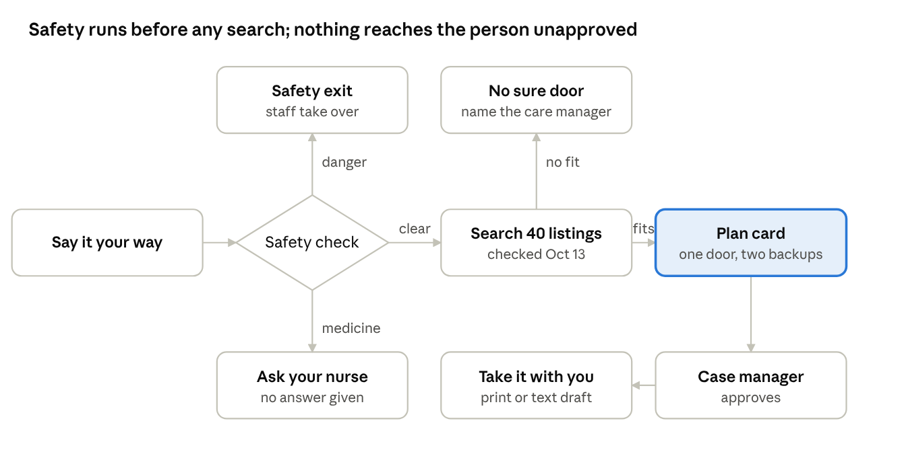

# Next Door — design handoff

Oct 17, 2026 · Freddie Jiang (design lead)

Live version of this doc: [Next Door — design handoff](https://claude.ai/code/artifact/049a41ec-61d5-467d-8e23-bf30e8efee21)

## What we're building

Next Door turns a discharge from IHH recuperative care into one plain-language plan. The person says what they need and a safety check runs first. The tool then picks one door from the 40 checked listings, a case manager approves it, and the person takes it home on paper or as a text draft. The tool never sends anything.

Everything below uses the IHH design system, the 12 made-up scenarios and the seed list checked Oct 13, 2026.

| File | What's in it | Who opens it |
|---|---|---|
| [Client framework](https://claude.ai/artifact/D12oCwqgqXQFxBLFng1HB6) · source in [`canvases/client/`](canvases/client/) | Phone, desktop and accessible client screens, plus the rules for each | Front end, design, QA |
| [Case manager and leadership](https://claude.ai/artifact/FedmJPdtSPrqV7yHjRmuK8) · source in [`canvases/case-manager/`](canvases/case-manager/) | Today dashboard, review a plan, safety steps, staff rules, leadership gaps report | Front end, AI and data |
| [IHH design system](https://claude.ai/artifact/3Cumbrc9HGPghRQJECv1HX) · copy in [`design-system/`](design-system/) | Colors, type, components, logos | Front end |
| [Working prototype](https://claude.ai/artifact/6e9rmaygmHsUphwsFwhLWG) · copy in [`prototype/`](prototype/) | Matching logic running over the seed data, in an older layout | AI and data |
| [Design principles by challenge](https://claude.ai/artifact/MVkXYgot1Gt8RZ7RapjByQ) | Judging, guardrails, game plan, demo script | Everyone |

The case manager canvas stays private until Freddie shares it from its Share menu.

## Why it looks this way

The look comes from IHH's own website, so the tool feels like IHH and not a generic app. Every visual choice serves a stressed person on a cheap phone.

- **IHH's brand, not a new one.** Sunflower yellow, midnight navy, warm sand, Playfair headlines and Archivo text all come from illuminationhealthhome.org. People and staff already trust that look.
- **Calm, not clinical.** Square corners, no shadows, no gradients and no hospital blue. Depth comes from solid color blocks, as on the IHH site. It reads as dignified, not institutional.
- **Each color has one job.** Yellow means act (the one button, the help strip). Navy means safety. Indigo means a medicine question. Sand holds the person's own words and resting blocks. One glance tells you what kind of screen you're on.
- **One thing per screen.** One question, one idea, one yellow button. People leaving care are tired and anxious, and fewer choices mean fewer mistakes.
- **Uncertainty is visible.** A filled, half-filled or dashed square shows how sure a fact is. It uses shape, not color, so it survives a black-and-white printout and color blindness.
- **Help is always on screen.** The yellow 9-1-1 / 2-1-1 strip sits on every client screen, as it does on IHH's site.
- **One left edge.** Text lines up on the gutter and only button labels are centered, so the eye has one path down the screen.
- **Big type, big targets.** Body text is 18 px on phone and 20 px on desktop, and buttons are at least 56 px tall. This is for older eyes, shaky hands and cracked screens.

## Screens

The canvases hold 18 client screens and 4 staff screens, all clickable. Build the rows marked Demo first.

| Screen | User | Where | Priority |
|---|---|---|---|
| Start: language list + Make it easier | Person leaving care | Client · Phone · 1 | Demo |
| Say it your way | Person leaving care | Client · Phone · 2 | Demo |
| Plan card (Ray) | Person leaving care | Client · Phone · 3 | Demo |
| Take it with you | Person leaving care | Client · Phone · 4 | Demo |
| Safety exit (Lena) | Person leaving care | Client · Phone · 5 | Demo |
| Medicine route (Bob) | Person leaving care | Client · Phone · 6 | Next |
| No sure door (Devon) | Person leaving care | Client · Phone · 7 | Demo |
| Printout, letter size | Person leaving care | Client · Phone · Printout | Demo |
| Start, plan, safety, no sure door, medicine | No smartphone, shared computer | Client · Desktop · D1–D5 | Next |
| Make it easier, tap to pick, plan step by step, safety, no sure door | Low vision, reading, hearing, motor | Client · Phone · Accessible · A1–A5 | Next |
| Today dashboard | Case manager | Case manager · Main | Demo |
| Review a plan (Ray) | Case manager | Case manager · Review | Demo |
| Safety steps (Lena) | Case manager | Case manager · Safety | Next |
| Gaps report | IHH leadership | Case manager · Leadership tab | Next |

Each canvas also has a framework board with the rules for its screens: phone, desktop, accessible and staff.

## Design system

Use the IHH tokens as they are. The only additions are the confidence marks, the button rule and the accessible type scale.

| Token | Value | Job |
|---|---|---|
| Yellow | `#FACC0A` | The one primary button, help strip, plan card head. Navy text only on it. |
| Navy | `#122640` | All text, top bar, safety screens, selected states |
| Indigo | `#1A2187` | Medicine route only |
| Sand | `#EDE5DE` | The person's own words, “what to say”, resting blocks |
| White | `#FFFFFF` | Ground |
| Charcoal | `#33373D` | Secondary text, never for anything that matters |

| Text | Phone | Desktop | Accessible |
|---|---|---|---|
| Question (Playfair 700) | 28 px | 40–42 px | 34 px |
| Body (Archivo 400) | 17–18 px | 18–20 px | 22 px |
| Phone number (Archivo 700) | 26 px | 28 px | 32 px |
| Labels (Archivo 600) | 12 px caps | 13 px caps | 17 px bold, sentence case |
| Primary button | 58 px tall | 64 px tall | 68 px tall |

**Buttons.** One primary button per screen: yellow fill, 2 px navy border, bold caps, and a → when it moves you on. On navy, the yellow button drops its border. Secondary buttons are white with a 2 px navy border. Everything else is a text link.

**Confidence marks.** A filled navy square means checked, high confidence. Half-filled means call to confirm. A dashed outline means unsure, and it is never the main door. Missing fields read “Not stated by source” in italics with a dashed underline.

**Alignment.** Every line starts on the 20 px gutter. The logo is always top left. Back links sit above the question, not in the top bar. Bullets hang outside the text edge.

**Never.** Rounded corners, shadows, gradients, yellow text on white, white text on yellow, emoji.

## Behavior specs

Danger and medicine words exit before any search runs. Only a listing that fits becomes a plan, and only an approved plan goes home.

- **Plan card.** A yellow head with the door's name and its check date. Then three numbered steps on one left edge: reach them, what to say, what to bring. Then why it may fit, two backups folded away, and “Nothing was sent.”
- **What to say.** Built in the person's language from their own needs and taps (walker, no ID, calls are hard). The printout adds English below for staff.
- **Safety exit.** Full navy, Quick exit at top right, 9-1-1 set large, no places shown. The case manager gets a 5-step checklist, and “Mark safe” stays outlined until every step is done.
- **Make it easier.** Reached from the start screen. It offers:
  - Bigger text.
  - Read it to me, with a “Now reading” caption.
  - Simple steps: one per screen, with “Step 1 of 4”.
  - “I can't hear well”: no call needed, 7-1-1 relay beside phone numbers, and a way to ask for an interpreter.
- **Desktop.** Two columns, with Print my plan as the main action. Start over is on every screen. The screen clears itself after 3 quiet minutes, and Esc is Quick exit.
- **Case manager review.** Each listing says why it ranked where it did. Swapping the door updates the preview and the text draft. Approve sits in the header with “Ray sees it next. Nothing is sent.”

## Data and guardrails

Every phone number, hour, address and rule on screen comes from a seed listing with its source and check date. If the listing is silent, the screen says so.

- **Source of truth.** The seed list of 40 resources, checked Oct 13, 2026 ([`../2-finding-the-right-resource/data/oc-resources.seed.json`](../2-finding-the-right-resource/data/oc-resources.seed.json)), and the 12 made-up scenarios ([`../2-finding-the-right-resource/scenarios/client-scenarios.json`](../2-finding-the-right-resource/scenarios/client-scenarios.json)). No real client data anywhere.
- **Matching.** Rank by confidence, then by fit. Fit checks the client's city against a listing's service area (Central or North SPA), city-ties rules and age limits. A listing that doesn't fit, such as a youth-only line for a 29-year-old, never becomes the main door.
- **No sure door.** If no high-confidence listing fits, show the no-sure-door screen and name the case manager. Log it for the gaps report.
- **Unknowns.** Missing hours become “Ask about hours when you call.” Medium confidence adds “Call to confirm first.”
- **Safety first.** Danger words stop the search before it runs. That path shows no addresses, no printout and no text draft. The seed list has no domestic violence hotline yet, so staff give one from IHH's own list.
- **Medicine.** Questions about medicine go to the nurse. The tool never answers them.
- **Never ask** for a name, ID number or immigration status. **Never send** anything; staff hand over text drafts and printouts.
- **Fit language.** “Likely a fit. Not a promise.” Never “you qualify”.

## Build checklist

Get the demo path working end to end before anything else: Ray, Lena, Devon, then Maria approving Ray. Feature freeze is 2:30 PM.

**Front end**

- [ ] Client phone: start, say it, plan card, take it with you, printout
- [ ] Safety exit and no-sure-door screens, wired to the safety check
- [ ] Case manager: Today dashboard and Review a plan, with Approve moving Ray to Plan handed over
- [ ] Make it easier: bigger text and simple steps (A1–A3)
- [ ] Desktop screens D1–D2 if time allows

**AI and data**

- [ ] Safety check before matching: danger and medicine words, all 12 scenarios
- [ ] Matching over the seed JSON with the fit rules above; return listing IDs only
- [ ] Fact check: every phone number, hour and address in the output matches its listing, or is removed
- [ ] Plain-language plan text and the Spanish version, with English below for staff

**QA and story**

- [ ] Run all 12 scenarios and log failures
- [ ] Pick one honest failure to show in the demo
- [ ] README: who it's for, what it does, what's mocked

**Mocked in the designs:**

- Staff names and caseloads.
- Which person each case manager owns.
- “Read it to me” (no audio yet).
- The 3-minute auto-clear on desktop.
- The Print buttons (the artifact viewer can't print).
- Outcomes on the gaps report.
- Eight of the ten languages (copy exists only in English and Spanish).

## Open questions for IHH

These answers change wording on screen, so ask an IHH staff member before the demo.

- [ ] Which domestic violence hotline should the tool show, with its hours and source?
- [ ] Does IHH have sign language interpreters, or should the screen say “Ask staff what help is available”?
- [ ] Which languages do clients need most after English and Spanish?
- [ ] Should a case manager approve every plan before the person sees it, or only some?
- [ ] How does IHH handle travel home and small loans today?
- [ ] Is a shared lobby computer or tablet available for the desktop version?
