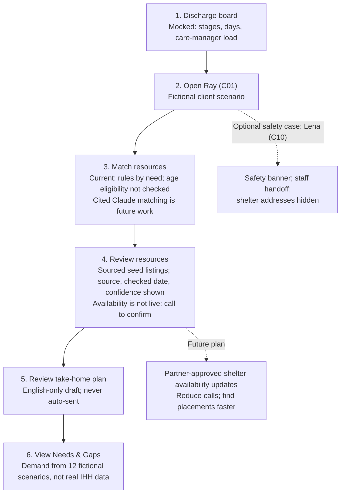

# Next Door Planner — Team Doc

2026-10-17 · Jiaying

## Problem

Clients leaving IHH recuperative care often walk out without a clear next step, even though Orange County has programs for most of their needs.

IHH named four needs: a place to sleep, help finding work, a small loan, and getting home to family. Three problems stand between a client and the right door:

1. **Finding the right fit.** Clients struggle to find the program that fits, know if they qualify, and make the first call.
2. **Thin coverage.** Shelter and work are well covered by public sources. Small loans and travel home have almost nothing public; 211OC has no category for either.
3. **Availability.** A listed program may be full, waitlisted, referral-only, or closed today. Listings also go stale: operators change and phone numbers conflict. There is no public real-time source; the County's shelter bed reservation system requires a login. A wrong answer sends someone to a locked door.

In IHH's words, clients "can struggle searching for and accessing community resources to suit their specific needs."

## Goal and audience

**Goal:** every client leaves knowing exactly what to do today. Plans in the client's own language are the next build.

The client is who benefits; the care manager is who operates the tool.

| Person         | Situation                                                                              | What they need from us                                                         |
| -------------- | -------------------------------------------------------------------------------------- | ------------------------------------------------------------------------------ |
| IHH client     | Leaving recuperative care within days; may have no ID, a basic phone, limited mobility | A short plan in plain words: who to contact, when, and what to bring           |
| Care manager   | Plans discharges for several clients at once                                           | One screen to capture needs, see verified resources, and hand over a plan fast |
| IHH leadership | Decides on programs, partners, and funding                                             | Evidence of which needs have no good door in Orange County                     |

**Target success measure (not tracked in the current demo):** share of clients who leave with a confirmed first contact: someone called and reached, not just a listing handed over. Tracking this requires the planned care-manager availability and contact-outcome logging.

## Use cases

Four cases carry the demo; all clients are made up, from the challenge's 12 scenarios.

| Case                                | Client says                                       | What the tool does                                                                                                  | What it proves          |
| ----------------------------------- | ------------------------------------------------- | ------------------------------------------------------------------------------------------------------------------- | ----------------------- |
| Ray (C01): a bed in 5 days          | "I can't go back under the bridge with this leg." | Matches shelter and ID help; flags referral-only sites; writes a plain plan                                         | Day-one usefulness      |
| Lena (C10): not safe                | "I can't go back there. He'll find me."           | Safety banner, staff takes over, shelter addresses hidden                                                           | Safety guardrail        |
| Devon (C03): getting home to family | "My sister said come. I just can't get there."    | Shows the only 3 listings: two low-confidence, one marked likely ineligible (ages 12 to 21); logs the need as a gap | Honest about gaps       |
| Gaps view                           | (leadership)                                      | Ranks needs by demand against verified coverage                                                                     | Strategic value for IHH |

Backup cases: Bob (C11) asks about stopping his medication and is routed to the care team; Sam (C12) asks about a program that may no longer exist and sees the listing's checked date and confidence.

## Our solution

Next Door Planner turns a discharge into a plain-language plan backed by verified sources, and logs every need that has no good door.

**Three screens**

| Screen          | Who uses it              | What it does                                                                                                                                                                    |
| --------------- | ------------------------ | ------------------------------------------------------------------------------------------------------------------------------------------------------------------------------- |
| Discharge board | Care manager             | Kanban of clients by stage (Leaving soon → Needs captured → Matched → Plan handed over → Followed up), days to discharge, safety and thin-coverage flags, care manager load |
| Case workspace  | Care manager with client | Client's words and constraints, matched resources with source, checked date and confidence, and a numbered plan with a text draft that is never auto-sent                       |
| Needs & gaps    | IHH leadership           | KPIs and a coverage table ranking needs by demand against verified resources                                                                                                    |

**Guardrails**

- No invented phone numbers, addresses, hours, or eligibility. Unknown fields show "Not stated by source."
- A danger mention shows a safety banner, hands the case to staff, and hides shelter addresses.
- Medical questions are routed to the care team; no advice is given.
- Nothing is sent and nothing connects to IHH systems.

**Availability**

- Every resource shows its checked date and confidence; referral-only sites are flagged.
- The tool never claims a bed or slot is open. It shows "Availability unknown: call to confirm."

## Next challenge: shelter availability

**Scenario:** Up-to-date shelter availability can reduce repeated calls and help care managers find suitable placements faster.

**Future plan:** Agree with shelters what availability to share, how often to update it, and how referrals work. Start with a partner-approved feed; consider database access only with shelter approval. Show when information was last updated and treat stale availability as unknown.

**Partner value:** Co-design incentives with shelters, such as fewer unsuitable referrals, less coordination, useful demand insights, or operational support.

**Demo workflow: current, mocked, and future**

**Data:** the challenge's 40-resource seed list (checked 2026-10-13) and 12 made-up client scenarios.
